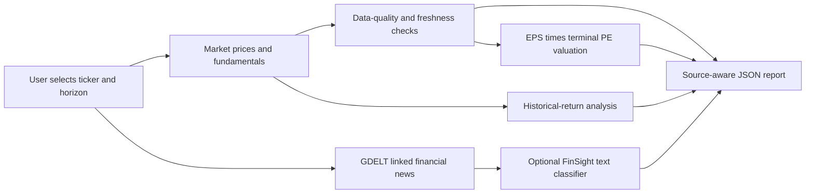

# FinSight Intelligence

**Company research, financial-news NLP and transparent valuation scenarios — in Python.**

[](https://github.com/tbharaj/finsight-ml-platform/actions/workflows/ci.yml)
[](LICENSE)
[](pyproject.toml)

**[▶ How to install and open the app](docs/QUICKSTART.md)** · **[📓 Company research notebook](notebooks/FinSight_Company_Intelligence.ipynb)** · **[📊 Dashboard source](intelligence_dashboard.py)** · **[Research methodology](docs/COMPANY_RESEARCH.md)**

FinSight brings together **dated historical market prices**, available company fundamentals, **linked financial news**, and a **financial-headline sentiment classifier** in an interactive Streamlit research dashboard. Choose a listed company's ticker and a **1–60-month horizon** to explore two deliberately distinct approaches:

1. **Earnings-multiple valuation:** Bear/base/bull implied values from user-defined annual EPS growth and terminal P/E assumptions. **Not** a prediction or analyst target.
2. **Historical-return scenarios:** Resampled past daily returns and a walk-forward diagnostic. **Not** a calibrated forward-price distribution or intrinsic value.

The app flags stale prices, mismatched/missing currencies, non-equity instruments, missing or negative EPS, and thin fundamentals rather than silently presenting a misleading P/E valuation. A research export preserves dates, sources, key assumptions and quality caveats.

> **Project status: research prototype.** This repository contains source code; **there is no hosted public web app**. Run Streamlit locally, or open the Jupyter notebooks. Market and news providers can be unavailable or rate-limited. No validated investment alpha, reliable future-price forecasting, or brokerage integration is claimed.

## Quick start — macOS / Linux

Clone once, then install in an isolated Python environment:

```bash
git clone https://github.com/tbharaj/finsight-ml-platform.git
cd finsight-ml-platform
python3 -m venv .venv
source .venv/bin/activate
python -m pip install -e '.[intelligence,notebook,data,dev]'
python -m streamlit run intelligence_dashboard.py
```

**Open the Local URL shown in Terminal** (normally `http://localhost:8501`), enter `NVDA` or another supported equity ticker, set the horizon, and click **Run company analysis**. Keep Terminal running; press `Control+C` to stop. If you already cloned the project, run `git pull --ff-only origin main` inside it instead of cloning a second time.

The full [step-by-step setup, usage walkthrough and troubleshooting guide](docs/QUICKSTART.md) covers earlier Terminal problems such as `quote>` prompts, running `pytest` from `~`, and accidentally using Anaconda's base environment.

## Jupyter notebooks

Use the **[Company Intelligence Notebook](notebooks/FinSight_Company_Intelligence.ipynb)** for a transparent company research workflow, or **[Financial Sentiment Notebook](notebooks/FinSight_Financial_Sentiment.ipynb)** for model training, evaluation and testing custom headlines:

```bash
python -m jupyter lab notebooks/FinSight_Company_Intelligence.ipynb
# or
python -m jupyter lab notebooks/FinSight_Financial_Sentiment.ipynb
```

Choose the `.venv` Python kernel, then **Run → Run All Cells**.

## What you can actually do

| Component | State | Where |
|---|---|---|
| Listed-company ticker lookup and adjusted historical prices | Implemented, provider-dependent | Dashboard: Market & fundamentals |
| Reported financial summary, with missing-data warnings | Implemented, reporting dates not fully reconciled | Dashboard: Market & fundamentals |
| 1–60-month EPS × terminal P/E bear/base/bull scenarios | Implemented, user-supplied assumptions | Dashboard: Price ranges & valuation |
| Historical return resampling and rolling interval diagnostics | Implemented, descriptive only | Dashboard: Price ranges & valuation |
| Company-name news search and clickable publisher links | Implemented, provider-dependent | Dashboard: Company news |
| Optional ML sentiment labels for headlines | Implemented after local training | `python -m finsight train` |
| Export research JSON with inputs, provenance and warnings | Implemented | Dashboard: Sources & export |
| Offline automated tests and GitHub Actions checks | Implemented | `tests/`, `.github/workflows/ci.yml` |
| Official SEC financial-statement extraction / audited DCF | **Not implemented** | Planned; see [methodology](docs/COMPANY_RESEARCH.md) |
| Verified trading forecasts, automated trade execution, adviser services | **Not implemented** | Out of scope |

### Example: research NVIDIA (illustrative workflow)

1. Enter **`NVDA`**, select **12 months** and **30 days** of news.
2. Read the last available adjusted closing-price date and financial metrics; examine the data-quality warnings.
3. Set justified EPS-growth and P/E assumptions; compare the three resulting **valuation scenarios**, not a guaranteed target.
4. Read the linked news articles; run the optional sentiment classifier if trained.
5. Download the dated JSON research report and verify financially material claims against **[NVIDIA Investor Relations](https://investor.nvidia.com/)** and **[SEC EDGAR](https://www.sec.gov/edgar/search/)**.

**Never** infer that a positive headline implies a positive stock return. This project separates sentiment classification from numerical valuation by design.

## Reproducible headline sentiment modelling

The original FinSight research studies whether individual financial headlines are **negative**, **neutral** or **positive**. It uses a TF–IDF + logistic-regression reference model and retains earlier experimental neural-network and DistilBERT scripts. It audits dataset labels, quarantines contradictory annotations, removes overlapping headlines across dataset splits and reports macro-F1, balanced accuracy and confusion matrices against a majority-class benchmark.

Train from the repository root:

```bash
python -m finsight train --output-dir artifacts
python -m finsight predict --text "The company raised full-year revenue guidance"
python -m pytest -q tests
```

The training command downloads the externally hosted [Financial PhraseBank](https://huggingface.co/datasets/lmassaron/FinancialPhraseBank). The resulting model is saved locally to `artifacts/sentiment_model.joblib` and is not included in the repository. **Do not load untrusted `.joblib` files.** Neither the dataset licence nor model performance on new news can be assumed to support commercial investment use. Financial PhraseBank data and third-party model licences are separate from this project's MIT code licence.

## Architecture



The optional headline sentiment model **does not alter price projections**. News-provider retrieval is not equivalent to independent verification or complete news coverage. The market-data adapter uses an unofficial Yahoo Finance interface; financial values can be stale, unavailable, or denominated in a different currency.

## Methods, caveats and sources

- [Getting started, access and troubleshooting](docs/QUICKSTART.md)
- [Company valuation methods and data limitations](docs/COMPANY_RESEARCH.md)
- [Sentiment model card](docs/MODEL_CARD.md)
- [Architecture](docs/ARCHITECTURE.md)
- [References](docs/REFERENCES.md)
- [Roadmap](docs/ROADMAP.md)

**Selected references:** [scikit-learn (Pedregosa et al., 2011)](https://jmlr.org/papers/v12/pedregosa11a.html), [Financial PhraseBank (Malo et al., 2014)](https://huggingface.co/datasets/lmassaron/FinancialPhraseBank), [GDELT DOC 2.0](https://blog.gdeltproject.org/gdelt-doc-2-0-api-debuts/), [Yahoo Finance/yfinance](https://ranaroussi.github.io/yfinance/reference/api/yfinance.Ticker.html), [SEC EDGAR](https://www.sec.gov/edgar/search/).

Code copyright © 2026 Taran Bharaj. See [MIT licence](LICENSE). Third-party data and model rights remain with their respective owners.
