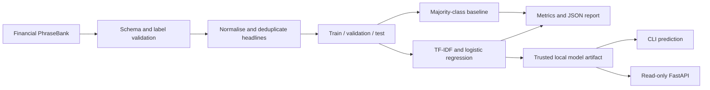

# FinSight

**Financial-news sentiment modelling | Reproducible ML research | Python · scikit-learn · PyTorch · Transformers · FastAPI**

[](https://github.com/tbharaj/finsight-ml-platform/actions/workflows/ci.yml)
[](LICENSE)

FinSight studies whether a financial headline can be classified as **negative**, **neutral**, or **positive**. The repository combines the existing exploratory neural-network and DistilBERT experiments with a **reproducible, end-to-end reference baseline**: data validation, global conflicting-label exclusion, duplicate-aware holdout handling, TF–IDF and logistic regression, majority-class benchmarking, JSON evaluation reports, model export, and an optional inference API.

> **Project status:** Research / portfolio project, not a production trading or investment system. The new baseline has offline unit tests; a full benchmark on the remote Financial PhraseBank dataset is **not claimed** until someone runs the training command and inspects the saved report. No financial returns or predictive advantage are claimed.

## What is implemented?

| Component | Status | Entry point |
|---|---|---|
| Dataset ingestion, schema checks, duplicate detection | Implemented | `finsight.data.splits` |
| Leakage-aware train / validation / test preparation | Implemented | `finsight.data.splits` |
| TF–IDF + logistic regression reference baseline | Implemented | `python -m finsight train` |
| Majority-class comparison, macro-F1, balanced accuracy, confusion matrix | Implemented | `artifacts/evaluation.json` after training |
| Local model export and single-headline prediction | Implemented | `python -m finsight predict` |
| Optional FastAPI inference service | Implemented | `uvicorn finsight.api:app` |
| Offline pytest suite and CI definition | Implemented | `tests/`, `.github/workflows/ci.yml` |
| Custom PyTorch neural classifier | Experimental existing code | `src/finsight/models/neural.py` |
| DistilBERT research script | Experimental existing code | `src/finsight/models/transformer.py` |
| FinBERT, RAG, FAISS search, anomaly detection, production MLOps | **Not implemented in this repository** | [Roadmap](docs/ROADMAP.md) |

## Architecture



## Run it locally

Requirements: Python 3.10 or newer. An internet connection is required **only for first-time dataset download**; the unit tests use synthetic fixtures and do not download data.

```bash
git clone https://github.com/tbharaj/finsight-ml-platform.git
cd finsight-ml-platform
python -m venv .venv
source .venv/bin/activate           # Windows: .venv\\Scripts\\activate
python -m pip install -e '.[data,api,dev]'
python -m pytest -q
python -m finsight train --output-dir artifacts
```

The training command writes `artifacts/evaluation.json` and `artifacts/sentiment_model.joblib`. **Inspect the generated values; the README deliberately reports no fabricated metrics.** The model is trained on the training split, compared on validation and test, and benchmarked against a majority-class predictor. Exact-text overlap across splits is removed with held-out examples prioritised. Headline text associated with contradictory labels anywhere in the source is excluded from all splits rather than assigned an arbitrary label. The report records raw row counts, conflicting headline/row exclusions and cleaned split sizes. The test split must not be used for hyperparameter selection.

Prediction from a trusted model you've trained locally:

```bash
python -m finsight predict --text "The company reported stronger annual profit"
uvicorn finsight.api:app --host 127.0.0.1 --port 8000
curl -s http://127.0.0.1:8000/predict \
  -H 'Content-Type: application/json' \
  -d '{"text":"Operating income increased during the quarter"}'
```

The API returns a class label and class probabilities. `GET /health` returns API health. The service has **no market-data feeds, brokerage credentials, trading controls or execution endpoints**. Do not expose this demonstration service directly to the public internet without authentication, rate limiting and operational hardening.

## Interactive Jupyter notebook — start here

For a guided financial-headline sentiment workflow covering source-data auditing, training, holdout evaluation, confusion matrices, model features and headline predictions, use the **[FinSight interactive notebook](notebooks/FinSight_Financial_Sentiment.ipynb)**.

```bash
# Run from the project root after activating the virtual environment
python -m pip install -e '.[data,notebook]'
python -m jupyter lab notebooks/FinSight_Financial_Sentiment.ipynb
```

Select the project's Python kernel, then **Run → Run All Cells**. The notebook reuses the packaged FinSight pipeline rather than duplicating modelling logic. A real-data run writes `artifacts/evaluation.json` and `artifacts/sentiment_model.joblib`, enabling subsequent CLI prediction. To run a *synthetic, offline* demonstration instead, start Jupyter after `export FINSIGHT_NOTEBOOK_SOURCE=synthetic`. Do **not** report synthetic scores as actual results.

The company-headline worksheet only classifies manually supplied text: it does not fetch live news, value companies or forecast returns.

## Research design and evaluation

- **Dataset:** [Financial PhraseBank on Hugging Face](https://huggingface.co/datasets/lmassaron/FinancialPhraseBank). The dataset contains labelled financial news headlines and lists a **CC BY-NC-SA 4.0** data licence. This licence is separate from the code's MIT licence; check its restrictions before reuse, particularly commercial use. We do not redistribute the dataset.
- **Labels:** `0 = negative`, `1 = neutral`, `2 = positive`, as defined by the source dataset.
- **Splits:** preserve the upstream train/validation/test splits when all three are supplied; otherwise make a deterministic stratified 70/15/15 split. Drop all annotations for any normalised headline with conflicting labels, then remove exact duplicates and overlapping headlines across splits. The report documents exclusions and final sample sizes.
- **Baseline:** word unigram/bigram TF–IDF features and class-balanced logistic regression, compared with a majority-class baseline.
- **Metrics:** accuracy, macro-F1, balanced accuracy and a 3×3 confusion matrix, on validation and test sets. Metrics are exported, not hard-coded.
- **Caveats:** classifying labelled news text is **not** forecasting asset returns. Editorial selection, historical periods, domain shift, annotation disagreement and dataset duplicates can affect apparent quality.

For methodology details, experiment gaps and citations, see [Model card](docs/MODEL_CARD.md), [Architecture](docs/ARCHITECTURE.md), and [References](docs/REFERENCES.md).

## Repository guide

```text
src/finsight/
  data/                  # Ingestion scripts and validated split preparation
  models/                # Original research scripts + reproducible sklearn model
  evaluation/            # Original error-analysis experiment
  training.py            # Benchmark training, reporting and artifact export
  inference.py           # Validated single-text inference
  api.py                 # Optional FastAPI read-only service
  cli.py                 # Train and predict commands
tests/                    # Offline synthetic-data tests
.github/workflows/ci.yml # Python 3.11 / 3.12 quality checks
docs/                     # Model card, architecture, references and roadmap
```

## Boundaries and responsible use

This is an educational financial-text classification system, **not investment advice** and not suitable for autonomous trading, investor profiling, lending decisions or time-critical market actions. The exported `.joblib` file uses Python pickle underneath; **never load artifacts from an untrusted source**. The old research scripts have not been made production-ready by the new reference pipeline. Contributions should include reproducible evidence and avoid data leakage.

## Primary references

1. Malo, P., Sinha, A., Korhonen, P., Wallenius, J., & Takala, P. (2014). *Good debt or bad debt: Detecting semantic orientations in economic texts*. Journal of the Association for Information Science and Technology, 65, 782–796. [Dataset record](https://huggingface.co/datasets/lmassaron/FinancialPhraseBank).
2. Pedregosa, F., et al. (2011). *Scikit-learn: Machine Learning in Python*. Journal of Machine Learning Research, 12, 2825–2830. [Paper](https://jmlr.org/papers/v12/pedregosa11a.html).
3. Sanh, V., Debut, L., Chaumond, J., & Wolf, T. (2019). *DistilBERT, a distilled version of BERT: smaller, faster, cheaper and lighter*. [arXiv](https://arxiv.org/abs/1910.01108).

Code released under [MIT](LICENSE). Third-party datasets and models retain their own licences.
