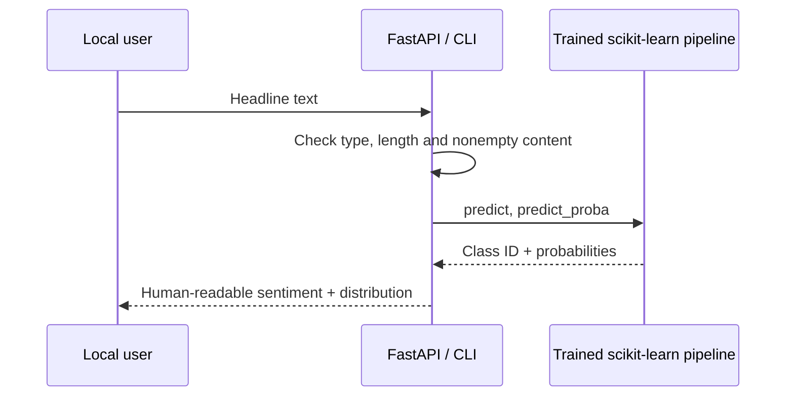

# Architecture and engineering decisions

## Reference inference path

## Training path

1. Fetch a permitted upstream dataset at runtime (`datasets.load_dataset`).
2. Validate `sentence`/`label` schema and labels 0/1/2; normalise whitespace and discard exact duplicate headlines within each split. Conflicting labels raise an error.
3. Preserve source train/validation/test splits when available; otherwise stratify unique rows into deterministic 70/15/15 partitions.
4. Detect and exclude exact-text overlap across partitions, prioritising test and validation over training examples. Record counts in report metadata.
5. Fit TF–IDF and class-balanced logistic regression to training data. Evaluate the model and a majority-class baseline on validation and test.
6. Save machine-readable JSON and a local model artifact. Git excludes generated outputs.

## Engineering choices

| Decision | Rationale | Limitation |
|---|---|---|
| Start with transparent TF–IDF + logistic regression | Cheap, inspectable reference point | Not state of the art for financial NLP |
| Add a majority-class benchmark | Makes class-imbalance gains measurable | A weak benchmark by design |
| Never fit text features on validation or test | Prevents feature-data leakage | Does not eliminate semantic near-duplicate leakage |
| Explicit JSON metrics | Makes results auditable and comparable | Dataset revision is not pinned yet |
| Dependency extras for API and research models | Avoids forcing heavy transformer dependencies for baseline tests | Experimental paths have separate requirements |
| Offline synthetic tests | CI is fast and does not require third-party dataset access | Full benchmark must be run separately |

## Security and deployment

The default service is intended for `127.0.0.1`. The API has no auth/rate limiting and should not be exposed to public traffic as-is. Treat joblib model files as executable-code-capable serialized objects, never as safe user uploads. Keep the dataset's noncommercial licensing separate from the repository's MIT code licence.

## Source annotation conflicts

The source can contain multiple sentiment labels for the same normalised headline. To avoid silently inventing a gold label, the baseline excludes **all** occurrences of a headline with contradictory labels across the complete source, before deduplication and model fitting. `evaluation.json` records the count of excluded headline keys and rows per original split. This policy changes the evaluated population and should be disclosed alongside any reported metrics.
